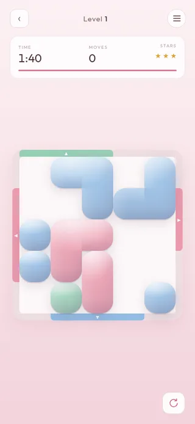
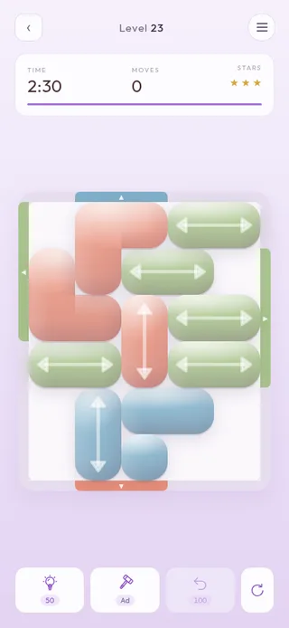
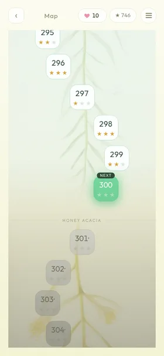
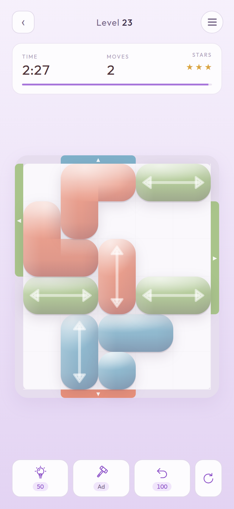
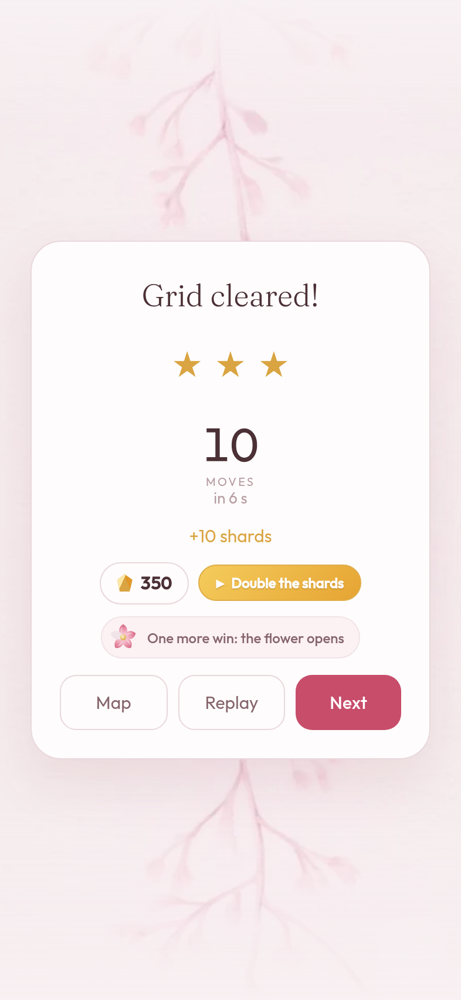
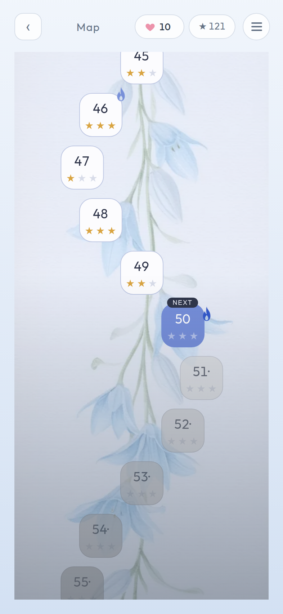
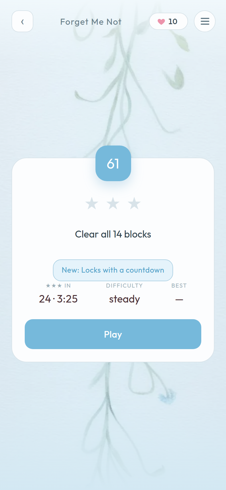
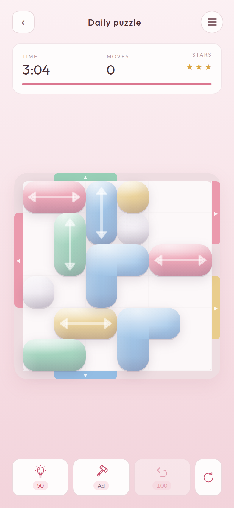
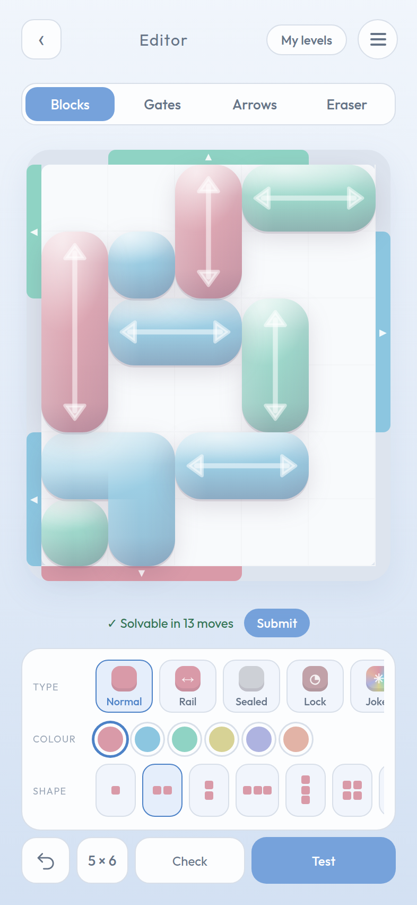

<div align="center">

# Quiet Puzzle

**A calm block puzzle. Slide each block to the door of its colour — and breathe.**

[**▶ Play in the browser**](https://romumrn.github.io/Quiet-puzzle/) · [**Get it on Google Play**](https://play.google.com/store/apps/details?id=com.romumrn.quietpuzzle)



</div>

No opponent, no countdown to panic over, no pressure. Just a grid, soft pastel blocks and coloured doors on the walls. Grab a block, drag it, and it glides out when it reaches a door of its colour that it fits through. The gesture is simple and repeatable — exactly what you want after a long day: something for your hands while your mind settles.

Every exit rings a note, one step higher than the last, so a good run of moves turns into a little melody. The music is played on real recorded instruments — piano, harp, hang drum, kalimba, water glasses — and the palette drifts from cherry blossom pink through wisteria, eucalyptus and autumn leaves as you travel.

## What's inside

- **1000 levels across 50 worlds**, each one proven solvable, each world bringing its own colours, its own branch on the map and a new idea.
- **A new mechanic every world** — blocks on rails, sealed blocks, locks that count down, jokers, anchors, gates with a capacity, heavy blocks, two-colour blocks, a key that opens every lock, one-way cells, blocks that slide until something stops them…
- **A daily puzzle**, the same grid for everyone, with a leaderboard — and on one day in two, a grid drawn by a player.
- **A level editor** with an exact solver: it tells you whether your grid can be solved and in how many moves, then lets you submit it to the community.
- **Gentle progression**: stars, daily quests, a flower that blooms one petal per level won, streak rewards.
- **A bulb that never guesses**: the hint runs an exact search on the board in play and shows the next move as a ghost.
- **Five languages** — English, French, Spanish, Italian, Chinese — and a colour-blind mode that gives each colour its own pattern.
- **Plays offline**, no account needed; sign in with Google to keep your progress across devices.

<table>
<tr>
<td align="center"><br><sub>Blocks on rails, world 2</sub></td>
<td align="center"><br><sub>Fifty worlds, one branch each</sub></td>
</tr>
</table>

| Play | Clear | Explore |
|:---:|:---:|:---:|
|  |  |  |
| **Discover** | **Every day** | **Create** |
|  |  |  |

## How to play

A block follows your finger one square at a time and stops at the first obstacle. Pressed against a door of its own colour and narrow enough to fit, it leaves the grid — a 3-cell piece will not go through a 2-cell door. Clear the board.

Fewer moves earn more stars. There is a clock, generous by design: a win past it still counts, it just earns no star.

## The repository

**[AGENTS.md](AGENTS.md)** is the project map: "I want to change X — what do I touch?", the invariants not to break, and the pitfalls already met. Read it before opening files.

The game is a no-build web app — plain HTML, CSS and native ES modules — wrapped unmodified into an Android app with Capacitor. Levels are generated offline, stored in Supabase, and read by the game.

| Folder | Purpose |
|---|---|
| `prototype/` | The game's source — where the work happens |
| `prototype/levels/` | The JSON level base, seed copy of what Supabase serves |
| `generator/` | The level generator (Node only): worlds, difficulty curve, search |
| `supabase/` | Database migrations: levels, progress, daily puzzle, leaderboards, community grids |
| `mobile/` | The Capacitor Android project and the Play Store listing |
| `docs/` | The published web site (GitHub Pages), built from `prototype/` |
| `media/` | README and Play Store images, all regenerated by a script |

## Development

Serve the game locally:

```bash
cd prototype && python3 -m http.server 8123
```

Run the tests (under a second; add `--solveur` to re-run the solver passes, several minutes, only after touching the solver, the generator or the levels):

```bash
node prototype/tools/test.mjs
```

Rebuild the levels after changing a world (`generator/realms.js`) or the generator, then publish them — the game reads the database, not the generator:

```bash
node prototype/tools/build-levels.mjs
```

```bash
node tools/publish-levels.mjs
```

See the whole difficulty curve on one page before tuning a world:

```bash
node generator/difficulty-map.mjs
```

Regenerate every image in this README and the Play Store screenshots in five languages (headless Chrome over a throwaway local server, from fabricated saves — never a hand-played session):

```bash
node prototype/tools/captures.mjs
```

`--only board,gameplay,store` limits the run; `--langs en,fr` the store languages.

## Publishing

The web site: `node prototype/tools/publier.mjs` writes `docs/` — modular sources, the level seed and the audio. Served as modules, it opens at about 400 KB and only fetches a world when the player begins it.

The Android app: `node tools/build-mobile-www.mjs`, then `npx cap sync android` in `mobile/`, then `./gradlew bundleRelease` in `mobile/android/`. Signing and the Play Store checklist are in [AGENTS.md](AGENTS.md#android-app).
